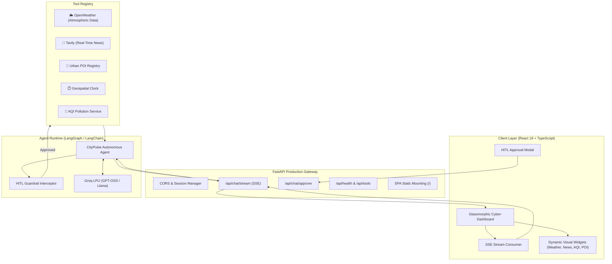

# 🏙️ CityPulse AI — Autonomous Urban Intelligence Platform

[](https://www.python.org/)
[](https://fastapi.tiangolo.com/)
[](https://www.langchain.com/)
[](https://groq.com/)
[](https://react.dev/)
[](https://www.typescriptlang.org/)
[](https://tailwindcss.com/)
[](https://www.docker.com/)

**CityPulse AI** is a production-grade, event-driven autonomous AI agent platform designed for real-time urban reconnaissance, environmental tracking, and geospatial intelligence. Powered by **Groq High-Speed LPUs**, **OpenWeatherMap**, and **Tavily Verified Search**, it autonomously coordinates multi-tool execution pipelines with streaming telemetry and interactive Human-in-the-Loop guardrails.

---

## 🌟 Resume & Portfolio Highlights

- **Event-Driven Agent Architecture**: Engineered with LangChain , utilizing tool-binding protocols and dynamic multi-step reasoning loops.
- **Real-Time SSE Streaming Telemetry**: Streams token chunks, intermediate agent thoughts, and tool execution lifecycles over Server-Sent Events (`/api/chat/stream`).
- **Interactive Human-In-The-Loop (HITL) Guardrails**: Non-blocking asynchronous approval flow (`/api/chat/approve`) allowing human operators to authorize or deny tool actions in real time directly from the chat UI.
- **Geospatial Intelligence Tool Suite**:
  - `get_weather`: Global geocoding coordinates, temperature in °C/°F, humidity, barometric pressure, wind vectors.
  - `get_news`: Tavily real-time web search with source citation metadata and URL verification.
  - `get_city_points_of_interest`: Curated urban landmarks, tech epicenters, and cultural hubs.
  - `get_city_time`: Timezone offset resolution, day/night period, and active business hours status.
  - `get_air_quality`: Real-time particulate levels (PM2.5, PM10, NO2) with health risk classification.
- **Glassmorphic Cyberpunk UI**: Built with React 19, TypeScript, and Tailwind CSS, featuring rich interactive widgets (Weather Card, News Dispatches, Clock, AQI Barometer), Speech Synthesis (TTS), and Markdown export.
- **Production-Ready & Containerized**: Single-port deployment via FastAPI static mount, multi-stage Docker build, health check endpoints, and OpenAPI/Swagger documentation.

---

## 📐 System Architecture



---

## 🚀 Quick Start Guide

### 1. Prerequisites
- Python 3.10+
- Node.js 18+ (for development or frontend re-compilation)
- Free API Keys:
  - **Groq API Key**: [console.groq.com](https://console.groq.com)
  - **OpenWeather API Key**: [openweathermap.org](https://openweathermap.org/api)
  - **Tavily API Key**: [tavily.com](https://tavily.com)

### 2. Environment Configuration
Create a `.env` file in the root directory (or copy from `.env.example`):
```bash
cp .env.example .env
```
Populate your API keys in `.env`:
```ini
GROQ_API_KEY=gsk_...
OPENWEATHER_API_KEY=...
TAVILY_API_KEY=tvly-...
DEFAULT_MODEL=openai/gpt-oss-120b
```

### 3. Install Python Dependencies
```bash
pip install -r requirements.txt
```

---

## 💻 Running the Application

### Option A: Complete Web Platform (Recommended)
Launch the unified production server (serves both API and the pre-built React UI on a single port):
```bash
python Agents.py --serve
```
👉 Open your browser at: **`http://localhost:8000`**  
👉 Interactive API Documentation: **`http://localhost:8000/docs`**

---

### Option B: Interactive Terminal CLI Mode
Want to test the enhanced agent in pure CLI with terminal graphics and rich tables?
```bash
python Agents.py --cli
```

---

### Option C: Development Mode (Vite Hot-Reload)
Run FastAPI backend and Vite frontend separately for live frontend code editing:

**Terminal 1 (Backend):**
```bash
python Agents.py --serve --reload
```

**Terminal 2 (Frontend Dev Server):**
```bash
cd frontend
npm install
npm run dev
```
👉 Development UI URL: **`http://localhost:5173`** (automatically proxies API requests to backend port 8000).

---

## 🐳 Docker Deployment

Run the complete platform inside a hardened, isolated Docker container:

```bash
# Build and run with Docker Compose
docker-compose up --build -d

# Or build directly with Docker
docker build -t citypulse-agent .
docker run -p 8000:8000 --env-file .env citypulse-agent
```

---

## 📡 REST & Streaming API Reference

| Method | Endpoint | Description |
|---|---|---|
| `POST` | `/api/chat/stream` | Server-Sent Events (SSE) streaming chat endpoint |
| `POST` | `/api/chat/approve` | Human-In-The-Loop approval/rejection endpoint |
| `GET` | `/api/sessions` | List active chat sessions |
| `POST` | `/api/sessions` | Create a new session |
| `GET` | `/api/sessions/{id}/messages` | Get message history and tool trace records |
| `DELETE` | `/api/sessions/{id}` | Delete a session |
| `GET` | `/api/tools` | Schema catalog of all registered agent tools |
| `GET` | `/api/health` | Health checks and API key configuration status |

---

## 🛡️ Human-In-The-Loop (HITL) Guardrail Modes

The agent supports 3 runtime guardrail security modes:
1. **Auto-Pilot (`auto`)**: Autonomous execution of all tools without human pause.
2. **Guarded (`sensitive_only`)**: Automatically executes safe read tools (weather, time), but prompts human operator approval for external search (`get_news`).
3. **Strict HITL (`always_ask`)**: Halts execution before every tool call, rendering an authorization card in the UI.

---

## 📜 License
MIT License. Built for production portfolios, high-performance demonstrations, and enterprise AI engineering.
